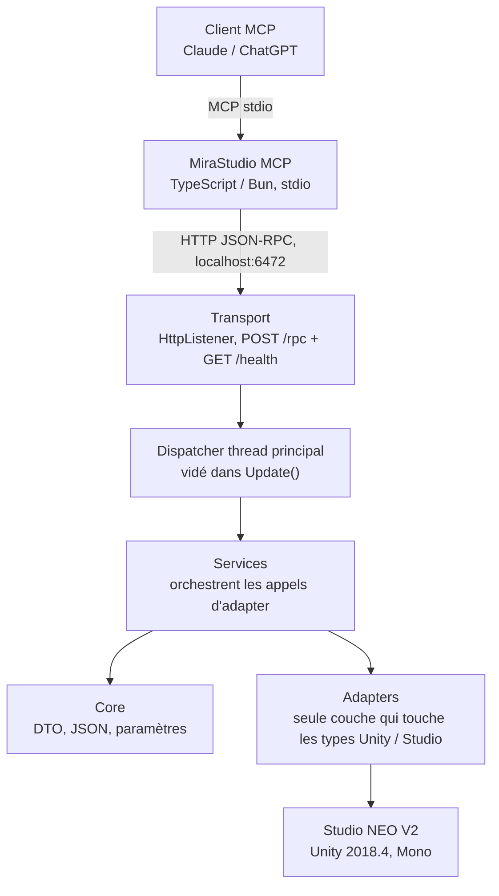

# MiraStudio

[](./docs/fr/tools.md) [](./docs/fr/architecture.md) [](./docs/fr/getting-started.md) [](./docs/fr/tools.md)

> "Une API sémantique de Studio NEO V2 pour agents IA — construire, inspecter et animer des scènes Honey Select 2 en langage naturel."

📖 [English](./README.md) · Français

[Démarrage](./docs/fr/getting-started.md) · [Tools](./docs/fr/tools.md) · [Plugins optionnels](./docs/fr/optional-plugins.md) · [Protocole](./docs/fr/protocol.md) · [Architecture](./docs/fr/architecture.md)

---

## 🧠 Qu'est-ce que MiraStudio ?

Un serveur MCP plus un plugin BepInEx qui laissent n'importe quel agent compatible MCP (Claude, ChatGPT, ...) piloter **Studio NEO V2**, l'éditeur de scènes de Honey Select 2 DX. L'agent lit la scène, crée objets et personnages, les pose os par os, règle l'environnement et vérifie le résultat par captures d'écran.

Deux briques partagent un seul contrat :

- **`MiraStudio.Plugin`** — un plugin BepInEx (C#, net46) qui tourne dans Studio et sert du JSON-RPC sur `localhost:6472`.
- **`mcp/`** — un serveur MCP (TypeScript sur Bun, stdio) qui expose 56 tools et transmet chacun au plugin.

L'entrée et la sortie de chaque tool sont décrites une seule fois, dans [`shared/schemas/`](./shared/schemas/) : un fichier JSON par tool. Le serveur MCP les importe directement ; le plugin les implémente.

```
Client MCP ──stdio──▶ MiraStudio MCP ──HTTP JSON-RPC──▶ MiraStudio.Plugin ──▶ Studio NEO V2
(Claude, ChatGPT)     (TypeScript / Bun)  localhost:6472   (BepInEx / C#)       (Unity 2018.4, Mono)
```

---

## 🚀 Démarrage rapide

```sh
# 1. Compiler et déployer le plugin (nécessite plugin/MiraStudio.Plugin/GamePath.local.props)
dotnet build plugin/MiraStudio.Plugin -c Release

# 2. Installer les dépendances du serveur MCP
cd mcp && bun install

# 3. Lancer Studio NEO V2, puis vérifier que le plugin répond
curl http://localhost:6472/health
```

Déclarer le serveur dans votre client MCP (le dépôt fournit un `.mcp.json`) :

```json
{
  "mcpServers": {
    "mirastudio": {
      "command": "bun",
      "args": ["run", "mcp/src/index.ts"]
    }
  }
}
```

Demandez ensuite une scène à votre agent. Sous le capot, il appelle des tools comme :

```text
studio_get_info            → Studio est-il prêt ?
studio_search_catalog      → trouver l'id d'un accessoire (les ids ne se devinent pas)
studio_create_object       → le créer
studio_set_camera          → le cadrer
studio_screenshot          → regarder le résultat
studio_save_scene          → le conserver
```

→ Pas à pas complet : [`docs/fr/getting-started.md`](./docs/fr/getting-started.md)

---

## 📦 Installation

Configuration cible :

| Composant | Version |
|---|---|
| Jeu | Honey Select 2 DX BetterRepack R16 (`StudioNEOV2.exe`, x64) |
| Moteur | Unity 2018.4.11f1, x64, Mono |
| Mod loader | BepInEx 5.4.23.2, HarmonyX 2.9 |
| Plugin | .NET Framework 4.6 (`net46`) |
| Serveur MCP | Bun |

Compiler le plugin (compile et copie `MiraStudio.dll` dans `BepInEx\Plugins\MiraStudio`) :

```sh
dotnet build plugin/MiraStudio.Plugin -c Release
```

Le build lit le dossier du jeu dans `plugin/MiraStudio.Plugin/GamePath.local.props` (non suivi par git). Copiez `GamePath.props.example` à côté et renseignez `GameDir`.

---

## ✨ Fonctionnalités

56 tools, groupés. Chaque écriture prend des valeurs absolues et n'applique que les champs passés, donc rejouer un appel est sans risque.

```text
-- Lecture (15)
studio_get_info  studio_get_scene  studio_list_characters  studio_list_objects  studio_get_camera
studio_screenshot  studio_search_catalog  studio_list_scenes  studio_list_character_cards
studio_list_poses  studio_list_coordinates  studio_list_outfit  studio_list_attach_points
studio_list_bones  studio_list_overlays

-- Scène et objets (9)
studio_load_scene  studio_save_scene  studio_set_camera  studio_create_object  studio_create_light
studio_set_light  studio_set_object_transform  studio_delete_object  studio_attach_object

-- Workspace (4)
studio_set_object_visible  studio_rename_object  studio_create_folder  studio_duplicate_object

-- Personnages (10)
studio_create_character  studio_set_character_pose  studio_set_character_anime
studio_set_character_expression  studio_set_character_hands  studio_set_character_outfit
studio_set_character_state  studio_set_character_kinematics  studio_set_character_bone
studio_set_character_ik

-- Environnement (4)
studio_set_map  studio_set_scene_lighting  studio_set_overlay  studio_set_post_processing

-- Batch (1)
studio_execute_batch

-- Plugins optionnels (13)
studio_timeline_*   (9)   animation par keyframes
studio_constraint_* (4)   contraintes de nœuds
```

Deux plugins tiers sont reliés quand ils sont installés : **Timeline** et **NodesConstraints**. Leurs tools sont toujours listés ; sans le plugin, ils échouent avec une erreur lisible. Voir [`docs/fr/optional-plugins.md`](./docs/fr/optional-plugins.md).

→ Chaque tool, ses paramètres et sa relecture : [`docs/fr/tools.md`](./docs/fr/tools.md)

---

## 📊 Architecture



Les types Unity et Studio s'arrêtent à la couche adapter ; tout ce qui est au-dessus parle en DTO, reflétés par les schémas JSON. Les API de Studio ne s'utilisent que sur le thread principal : le transport reçoit les requêtes sur des threads de travail et les exécute sur le thread principal d'Unity.

→ Couches, règles et journal des décisions : [`docs/fr/architecture.md`](./docs/fr/architecture.md) · Protocole : [`docs/fr/protocol.md`](./docs/fr/protocol.md)

---

## ⚠️ Limites connues

- Pas de routes ni de caméras dans la scène : aucun tool ne les crée ni ne les pilote.
- Pas de son : les voix et les réglages `bgmCtrl`, `envCtrl` et `outsideSoundCtrl` stockés dans la scène ne sont pas couverts.
- Changer la pièce de vêtement d'un emplacement est hors périmètre (territoire du character maker) ; les tenues se chargent depuis des fichiers de coordinate et les emplacements s'habillent ou se déshabillent.
- Plusieurs tools d'écriture vident la pile d'annulation de Studio : `studio_delete_object`, `studio_create_folder`, `studio_create_character`, `studio_attach_object`, et `studio_set_map` quand `no` est fourni.
- `studio_execute_batch` n'a pas de rollback : une étape qui échoue arrête le batch et les étapes précédentes restent appliquées.
- Timeline et NodesConstraints n'ont été testés que contre Timeline 1.4.1 et NodesConstraints 1.3.3.

---

## 🛠️ Build & tests

```sh
# plugin : compilation + déploiement dans BepInEx\Plugins\MiraStudio
dotnet build plugin/MiraStudio.Plugin -c Release

# serveur MCP : installation, typecheck, smoke test
cd mcp && bun install && bun x tsc --noEmit && bun run test/smoke.ts
```

Le smoke test lance le serveur MCP en stdio, liste les tools (56) et appelle `studio_get_info`. La liste fonctionne sans Studio ; `studio_get_info` demande que le plugin réponde.

Structure du dépôt :

```text
MiraStudio/
├── docs/{en,fr}/             # docs utilisateur, architecture, internes
├── plugin/MiraStudio.Plugin/ # plugin BepInEx (Core, Adapters, Services, Transport)
├── mcp/                      # serveur MCP (TypeScript / Bun)
├── shared/schemas/           # un schéma JSON par tool, partagé par le plugin et le MCP
└── tools/reverse-engineering/# scripts de dump d'assemblies / diagnostic
```

L'analyse de la cible est dans les internes : [`reverse-engineering`](./docs/fr/internals/reverse-engineering.md), [`studio-api`](./docs/fr/internals/studio-api.md), et les notes de découverte ([assemblies](./docs/fr/internals/discovery/assemblies.md), [BepInEx](./docs/fr/internals/discovery/bepinex.md), [API de modding](./docs/fr/internals/discovery/modding-apis.md), [runtime](./docs/fr/internals/discovery/runtime.md), [classes Studio](./docs/fr/internals/discovery/studio-classes.md), [UserData](./docs/fr/internals/discovery/userdata.md)).

---

## 💡 Philosophie

- Rétro-ingénierie d'abord — ne jamais coder contre une API imaginée.
- Les tools en lecture seule avant les tools d'écriture.
- Les types Unity et Studio ne sortent jamais de la couche adapter ; le MCP ne voit que l'API MiraStudio.
- Chaque tool MCP a un schéma JSON strict.
- Opérations idempotentes, ids stables, support du batch.
