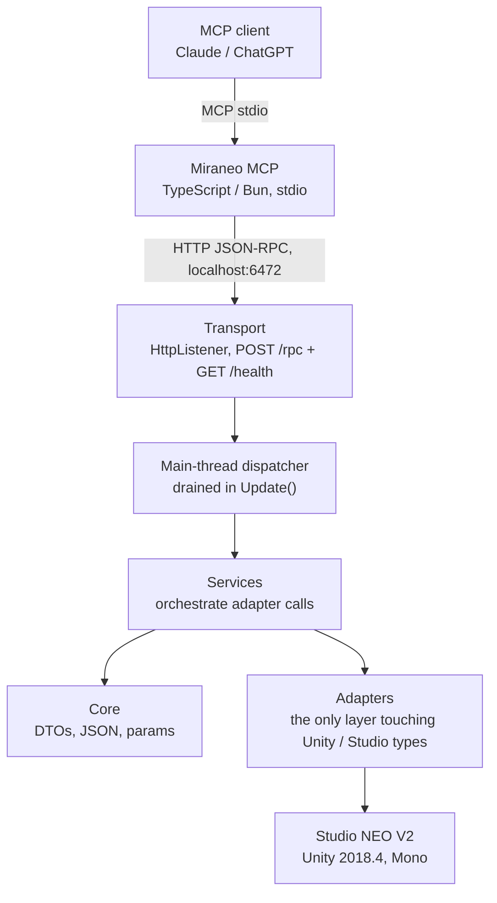

# Miraneo

[](./docs/en/tools.md) [](./docs/en/architecture.md) [](./docs/en/getting-started.md) [](./docs/en/tools.md)

> "A semantic Studio NEO V2 API for AI agents — build, inspect and animate Honey Select 2 scenes from natural language."

📖 English · [Français](./README.fr.md)

[Getting started](./docs/en/getting-started.md) · [Tools](./docs/en/tools.md) · [Optional plugins](./docs/en/optional-plugins.md) · [Protocol](./docs/en/protocol.md) · [Architecture](./docs/en/architecture.md)

---

## 🧠 What is Miraneo?

An MCP server plus a BepInEx plugin that let any MCP-compatible agent (Claude, ChatGPT, ...) drive **Studio NEO V2**, the scene editor of Honey Select 2 DX. The agent reads the scene, spawns objects and characters, poses them bone by bone, sets the environment, and looks at the result through screenshots.

Two pieces share one contract:

- **`Miraneo.Plugin`** — a BepInEx plugin (C#, net46) that runs inside Studio and serves JSON-RPC on `localhost:6472`.
- **`mcp/`** — an MCP server (TypeScript on Bun, stdio) that exposes 56 tools and forwards each one to the plugin.

The input and output of every tool is described once, in [`shared/schemas/`](./shared/schemas/): one JSON file per tool. The MCP server imports them directly; the plugin implements them.

```
MCP client ──stdio──▶ Miraneo MCP ──HTTP JSON-RPC──▶ Miraneo.Plugin ──▶ Studio NEO V2
(Claude, ChatGPT)     (TypeScript / Bun)  localhost:6472   (BepInEx / C#)       (Unity 2018.4, Mono)
```

---

## 🚀 Quickstart

```sh
# 1. Build and deploy the plugin (needs plugin/Miraneo.Plugin/GamePath.local.props)
dotnet build plugin/Miraneo.Plugin -c Release

# 2. Install the MCP server dependencies
cd mcp && bun install

# 3. Start Studio NEO V2, then check the plugin answers
curl http://localhost:6472/health
```

Register the server in your MCP client (this repository ships a `.mcp.json`):

```json
{
  "mcpServers": {
    "miraneo": {
      "command": "bun",
      "args": ["run", "mcp/src/index.ts"]
    }
  }
}
```

Then ask your agent for a scene. Under the hood it calls tools such as:

```text
studio_get_info            → is Studio ready?
studio_search_catalog      → find the id of a prop (ids cannot be guessed)
studio_create_object       → spawn it
studio_set_camera          → frame it
studio_screenshot          → look at the result
studio_save_scene          → keep it
```

→ Full walkthrough: [`docs/en/getting-started.md`](./docs/en/getting-started.md)

---

## 📦 Install

Target setup:

| Component | Version |
|---|---|
| Game | Honey Select 2 DX BetterRepack R16 (`StudioNEOV2.exe`, x64) |
| Engine | Unity 2018.4.11f1, x64, Mono |
| Mod loader | BepInEx 5.4.23.2, HarmonyX 2.9 |
| Plugin | .NET Framework 4.6 (`net46`) |
| MCP server | Bun |

Build the plugin (compiles and copies `Miraneo.dll` into `BepInEx\Plugins\Miraneo`):

```sh
dotnet build plugin/Miraneo.Plugin -c Release
```

The build reads the game folder from `plugin/Miraneo.Plugin/GamePath.local.props` (untracked). Copy `GamePath.props.example` next to it and set `GameDir`.

---

## ✨ Features

56 tools, grouped. Every write takes absolute values and applies only the fields you pass, so repeating a call is safe.

```text
-- Read (15)
studio_get_info  studio_get_scene  studio_list_characters  studio_list_objects  studio_get_camera
studio_screenshot  studio_search_catalog  studio_list_scenes  studio_list_character_cards
studio_list_poses  studio_list_coordinates  studio_list_outfit  studio_list_attach_points
studio_list_bones  studio_list_overlays

-- Scene and objects (9)
studio_load_scene  studio_save_scene  studio_set_camera  studio_create_object  studio_create_light
studio_set_light  studio_set_object_transform  studio_delete_object  studio_attach_object

-- Workspace (4)
studio_set_object_visible  studio_rename_object  studio_create_folder  studio_duplicate_object

-- Characters (10)
studio_create_character  studio_set_character_pose  studio_set_character_anime
studio_set_character_expression  studio_set_character_hands  studio_set_character_outfit
studio_set_character_state  studio_set_character_kinematics  studio_set_character_bone
studio_set_character_ik

-- Environment (4)
studio_set_map  studio_set_scene_lighting  studio_set_overlay  studio_set_post_processing

-- Batch (1)
studio_execute_batch

-- Optional plugins (13)
studio_timeline_*   (9)   keyframe animation
studio_constraint_* (4)   node constraints
```

Two third-party plugins are bridged when installed: **Timeline** and **NodesConstraints**. Their tools are always listed; without the plugin they fail with a readable error. See [`docs/en/optional-plugins.md`](./docs/en/optional-plugins.md).

→ Every tool, its parameters and its read-back: [`docs/en/tools.md`](./docs/en/tools.md)

---

## 📊 Architecture



Unity and Studio types stop at the adapter layer; everything above speaks DTOs mirrored by the JSON schemas. Studio's APIs are main-thread only, so the transport receives requests on worker threads and runs them on the Unity main thread.

→ Layers, rules and the decisions log: [`docs/en/architecture.md`](./docs/en/architecture.md) · Wire protocol: [`docs/en/protocol.md`](./docs/en/protocol.md)

---

## ⚠️ Known limits

- No routes and no in-scene cameras: no tool creates or drives them.
- No sound: voices and the `bgmCtrl`, `envCtrl` and `outsideSoundCtrl` settings stored in the scene are not covered.
- Changing the clothing item of a slot is out of scope (character-maker territory); outfits are loaded from coordinate files and slots are dressed or undressed.
- Several write tools clear Studio's undo stack: `studio_delete_object`, `studio_create_folder`, `studio_create_character`, `studio_attach_object`, and `studio_set_map` when `no` is given.
- `studio_execute_batch` has no rollback: a failing step stops the batch and the earlier steps stay applied.
- Timeline and NodesConstraints were tested against Timeline 1.4.1 and NodesConstraints 1.3.3 only.

---

## 🛠️ Build & tests

```sh
# plugin: compile + deploy into BepInEx\Plugins\Miraneo
dotnet build plugin/Miraneo.Plugin -c Release

# MCP server: install, typecheck, smoke test
cd mcp && bun install && bun x tsc --noEmit && bun run test/smoke.ts
```

The smoke test spawns the MCP server over stdio, lists the tools (56) and calls `studio_get_info`. The listing works without Studio; `studio_get_info` needs the plugin to answer.

Repository layout:

```text
Miraneo/
├── docs/{en,fr}/             # user docs, architecture, internals
├── plugin/Miraneo.Plugin/ # BepInEx plugin (Core, Adapters, Services, Transport)
├── mcp/                      # MCP server (TypeScript / Bun)
├── shared/schemas/           # one JSON schema per tool, shared by plugin and MCP
└── tools/reverse-engineering/# assembly dump / diagnostic scripts
```

How the target was analysed lives in the internals: [`reverse-engineering`](./docs/en/internals/reverse-engineering.md), [`studio-api`](./docs/en/internals/studio-api.md), and the discovery notes ([assemblies](./docs/en/internals/discovery/assemblies.md), [BepInEx](./docs/en/internals/discovery/bepinex.md), [modding APIs](./docs/en/internals/discovery/modding-apis.md), [runtime](./docs/en/internals/discovery/runtime.md), [Studio classes](./docs/en/internals/discovery/studio-classes.md), [UserData](./docs/en/internals/discovery/userdata.md)).

---

## 💡 Philosophy

- Reverse-engineer first — never code against an imagined API.
- Read-only tools before write tools.
- Unity and Studio types never leak past the adapter layer; the MCP only sees the Miraneo API.
- Every MCP tool has a strict JSON schema.
- Idempotent operations, stable ids, batch support.
